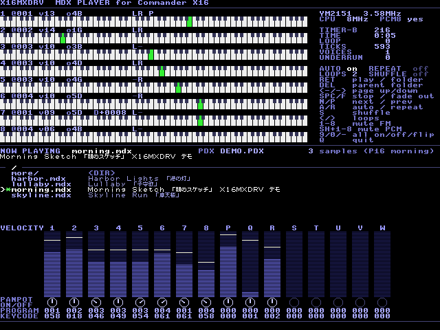

# x16mxdrv — Commander X16 で MDX を鳴らす

[English](README.md)

**ベータ版です。** X68000 の MDX(と PDX の ADPCM)を、
[Commander X16](https://www.commanderx16.com/) で鳴らします。次の 2 つでできています。

- **X16MXDRV**(`X16MXDRV.BIN`):MDX をファイルのまま鳴らすドライバです。RAM バンクに置いて
  動くので、ゲームなどの BGM にも使えます。
- **mdxplay**(`MDXPLAY.PRG`):ドライバを使った音楽プレイヤーです。チャンネルごとの鍵盤、
  レベルメーター、パン、曲のタイトルを表示します。タイトルは Shift_JIS で、8×8 の漢字
  フォントで描きます。



*この画像のために作ったデモ曲(FM 8 チャンネルと PCM のドラム 3 音)を、x16emu で再生しているところです。*

X16MXDRV は、X68000 の MXDRV 2.06+17 の動作を 65C02 のアセンブリで一から書き直した、
**非公式の独自実装**です。MXDRV の作者の方々とは関係がありません([クレジット](#クレジット))。

## 特徴

- **FM:** YM2151(OPM)と YM2164(OPP)に対応します。
  - FM の出力は MXDRV に合わせてあります。試験では、レジスタへの書き込みが MXDRV
    (portable_mdx)と 1 回ずつ、tick ごとに一致しています。
  - X16 の YM のクロック(3.58MHz)に合わせて、音程を補正します。
- **PCM:** PCM8 互換で、最大 8 音(既定は 4 音)です。ソフトウェアで合成し、VERA の PCM で
  鳴らします。
  - PDX は、読み込みながら X16 の上で展開します。
  - PC であらかじめ作っておく **P16 パック**から読むこともできます。こちらはずっと速く
    読めます。PCM の多い曲で、PDX の展開はエミュレータで約 18 秒かかります(実機 OtterX では、
    以前の少し重い展開処理で 23 秒でした)。その曲のパックは、エミュレータで、ホストのフォルダ
    から約 1 秒、SD カードのイメージから約 5 秒です。
  - サンプルには、X68000 の出力と同じ 183Hz のハイパスをかけます。X68000 のローパスは、PC 上で
    `mkpack.py --x68filter` を使って加えられます(下)。
- **使う資源:** RAM バンク 4 本、golden RAM の `$0400`〜`$07FF`、それに再生中の VIA1 タイマー 1 と
  IRQ ベクタです。ゼロページは専用には使いません。
  - VERA の PSG は使わないので、効果音に使えます。
- **CPU の負荷(8MHz):** FM だけの曲で約 10〜14%、PCM8 を 4 音使う曲で約 30〜50% です。
- **呼び出し方:** prog8、ca65、cc65 から呼べます。それぞれの定義が `driver/include/` にあります。

プレイヤーでできること:

- **一覧:** フォルダ、MDX の順に、それぞれ名前順で並べます。フォルダの出入りもできます。
- **再生のモード:** 自動で次の曲へ、リピート、フェードアウトまでのループ回数、シャッフル。
- **チャンネルのミュート:** FM と PCM のチャンネルを 1 つずつ消せます。消したチャンネルも曲は
  進んでいて、戻すとその場から鳴ります。
- **曲の PCM:** 曲ごとに、P16 パックがあればそれを使います。なければ PDX、それもなければ
  FM だけで鳴らします。

## 動作環境

- Commander X16 の新しい ROM が要ります。R48 を推奨します。プレイヤーのキー操作には R43
  以降が必要です。
- **RAM:** 512KB の機種では FM だけ鳴らせます。PCM にはそれより多い RAM が要り、2MB を推奨します。
- **確認した環境:** x16emu R48 と OtterX(X16 互換の FPGA 機、YM2151 互換)です。YM2164 の機種
  ではまだ確かめていません。

## プレイヤーの使い方

1. `X16MXDRV.BIN`、`MDXPLAY.PRG`、`KANJI8.BIN` を、SD カードの同じフォルダに置きます。
   リリースのファイルか、`make dist` で作ったものを使います。
2. MDX は、そのフォルダかその下のフォルダに置きます。PDX(と P16 パック)は、その曲の MDX と
   同じフォルダに置いてください。
3. X16 で、そのフォルダから `LOAD "MDXPLAY.PRG",8` と `RUN` を実行します。たとえば先に
   `DOS "CD:MDXPLAY"` でそのフォルダへ移ります。

| キー | |
|---|---|
| 上 / 下 | 選ぶ |
| 左 / 右 | ページ送り |
| RETURN | MDX を再生 / フォルダに入る |
| DEL | 上のフォルダへ |
| SPACE / F | 停止 / フェードアウト |
| N / P | 次 / 前の曲 |
| A / R / S | 自動で次へ / リピート / シャッフルの切り替え |
| `<` / `>` | フェードアウトまでのループ回数 |
| 1〜8 | FM の 1〜8 をミュート |
| SHIFT(または CTRL)+ 1〜8 | PCM の P〜W をミュート |
| 9 / 0 / - | 全チャンネルをオン / オフ / 反転 |
| Q | 終了 |

数字のキーは位置で読むので、キーボードの配列によらず同じ所で効きます。

制限:
- **MDX の大きさ:** 65535 バイト(64KB)までです。それより大きいファイルは鳴らしません。
- **一覧の項目数:** 1 つのフォルダに 128 項目までです。
- **長いファイル名:** 64 文字以上のファイル名は、一覧に出ません。
- **長いパス:** パスが 80 文字を超えるフォルダでは、再生中の曲に印が付きません。

## P16 パック(PCM の読み込みを速くする)

```
python3 tools/mkpack.py DIR [-r]     # DIR の MDX が使う PDX ごとに、共有パック <PDX 名>.P16
python3 tools/mkpack.py SONG.MDX     # 1 曲用のパック SONG.P16
python3 tools/mkpack.py DIR --check  # パックが今の MDX・PDX に合っているか調べる
```

- **中身:** サンプルを、ドライバが展開するのとビット単位で同じに展開して収めています。
  どちらで鳴らしても音は同じです。
- **共有パック:** 同じ PDX を使う曲すべてで、1 つのパックを使えます。
- **作り直し:** 曲を足したら、フォルダを指定して作り直してください。183Hz のハイパスより前に
  作ったパックは、PDX から鳴らした音と違います。`--check` で見つけられます。
- **`--x68filter`(numpy が要ります):** X68000 のアナログの出力フィルタもかけます。丸い、
  X68000 らしい PCM の音になります。
  - このパックは、X16 が PDX から展開するものとは違う音になります。
  - フィルタの特性は、各サンプルのレートの半分まで近似します。それより上(サンプルをそのレートで
    鳴らすときに生じる成分)には、どのレートでも効きません。
  - サンプルの長さは変えないので、末尾の後のフィルタの余韻は切れます。
  - 詳しくは [docs/api.ja.md](docs/api.ja.md) の 4.1 節。
- **オプション:** `tools/mkpack.py --help` を見てください。形式は
  [docs/api.ja.md](docs/api.ja.md) にあります。

## 自分のプログラムでドライバを使う

API、使う資源、prog8・ca65・cc65 の例は [docs/api.ja.md](docs/api.ja.md) にあります
(英語版は [docs/api.md](docs/api.md))。完全な例は次の 2 つです。
- `demo/stardemo.p8`:BGM を鳴らす小さなゲームです。同じフォルダに `BGM.MDX` と `BGM.P16`
  (または PDX)が要ります。
- `demo/cc65demo.c`:C から使う例です。`TEST.MDX` と `TEST.P16` が要ります。

## ビルド

[cc65](https://cc65.github.io/) 2.19 以降、[prog8](https://github.com/irmen/prog8) 12 以降
(Java が要ります)、Python 3 を使います。

```
make          # build/driver/X16MXDRV.BIN、build/player/MDXPLAY.PRG、build/player/KANJI8.BIN
make dist     # build/dist/ に 3 つのファイルと README.TXT、LICENSE.TXT、MISAKI.TXT
make demo cc65demo
```

## 状況

ベータ版です。不具合の報告を歓迎します。MDX ファイルは、共有してよいものだけを添えてください。
症状の説明だけでもかまいません。

## ライセンス

MIT です([LICENSE](LICENSE))。`KANJI8.BIN` の元にしている `thirdparty/misaki/` の美咲フォントは、
独自のフリーなライセンスです(`thirdparty/misaki/misaki.txt`)。

## クレジット

- **MXDRV:** milk.、K.MAEKAWA、Missy.M、Yatsube の各氏。
  - X16MXDRV は、その動作を書き直したものです。
  - `driver/src/mxtables.inc` の音程・音量などの表は、MXDRV から取っています。
  - `driver/src/mxcore.s` のコメントには、対応する MXDRV のルーチンの名前を書いています。
- **portable_mdx:** yosshin4004 氏。MXDRV の C 移植(MXDRVg、GORRY 氏)と X68Sound をまとめたもの
  です。ドライバの出力を確かめるときの基準に使いました。
- **美咲フォント:** 門真なむ氏(https://littlelimit.net/)。プレイヤーの 8×8 の漢字に使っています。
- **mdxtools:** vampirefrog 氏。MDX・PDX の形式の資料を参考にしました。
- **Nano Drive 8:** Fujix1 氏(https://github.com/Fujix1/NanoDrive8)。そこで公開されている
  X68000 の ADPCM の出力フィルタの数値(183Hz の 1 次のハイパスと、X68000 CZ-600CE のコントロール
  回路図から導かれたローパスの特性)を使っています。ローパスの当てはめと、X16MXDRV・`mkpack.py`
  のフィルタは、このプロジェクトで作ったものです。
- **Commander X16:** X16 コミュニティの資料、エミュレータ、ROM。
