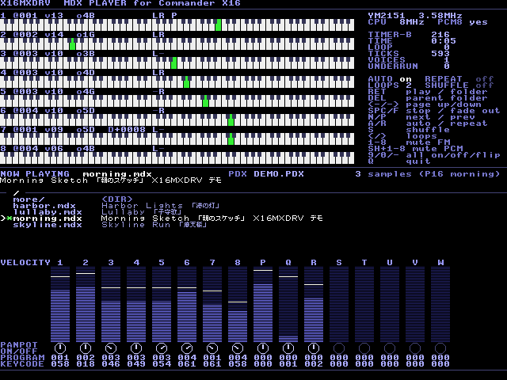

# x16mxdrv — MDX music for the Commander X16

[日本語](README.ja.md)

**Beta.** This project plays X68000 MDX music (with its PDX ADPCM samples) on the
[Commander X16](https://www.commanderx16.com/). It has two parts:

- **X16MXDRV** (`X16MXDRV.BIN`): a sound driver that plays MDX files as they are. It runs
  from banked RAM, so a game or another program can use it for background music.
- **mdxplay** (`MDXPLAY.PRG`): a music player built on the driver. It shows each
  channel's keyboard, level bars, panning and the song title (Shift_JIS, drawn with an
  8x8 kanji font).



*mdxplay playing a demo song made for this picture (FM 8 channels and 3 PCM drums), in x16emu.*

X16MXDRV is an **unofficial, independent reimplementation** of the behaviour of MXDRV
2.06+17 for the X68000, written from scratch in 65C02 assembly. It is not affiliated with
the authors of MXDRV. See [Credits](#credits).

## Features

- **FM:** YM2151 (OPM) and YM2164 (OPP). The FM output follows MXDRV: in tests, the
  register writes match MXDRV's (from portable_mdx) write for write and tick for tick.
  The driver adjusts the pitch for the X16's 3.58 MHz YM clock.
- **PCM:** PCM8-compatible, up to 8 voices (4 by default), mixed in software and played
  through VERA PCM.
  - PDX samples are decoded on the X16 while the PDX is read.
  - Alternatively, they can be read from a **P16 pack** made on a PC beforehand, which is
    much faster. For a PCM-heavy song, decoding the PDX takes about 18 seconds in the
    emulator (23 seconds on hardware, OtterX, with an earlier, slower decoder); its pack
    loads in about 1 second from the host folder and 5 seconds from an SD card image.
  - The samples get the X68000's 183 Hz output high-pass. The X68000's low-pass can be
    added on a PC with `mkpack.py --x68filter` (see below).
- **Resources:** 4 RAM banks, golden RAM `$0400`-`$07FF`, VIA1 timer 1 and the IRQ vector
  while playing. It needs no zero page of its own.
  - The VERA PSG is left free, so it can be used for sound effects.
- **CPU load at 8 MHz:** about 10-14% for FM-only songs, about 30-50% with 4 PCM8 voices.
- **Calling the driver:** prog8, ca65 and cc65 interfaces are in `driver/include/`.

The player:

- **File list:** folders, then MDX files, each in name order. Folders can be entered and
  left.
- **Playback modes:** auto-next, repeat, a loop count for the fade out, and shuffle.
- **Channel mute:** each FM and PCM channel can be muted. A muted channel keeps running;
  unmuting restores it where the song is.
- **Song PCM:** for each song, the player uses its P16 pack if there is one, else the PDX,
  else FM only.

## Requirements

- Commander X16 with a recent ROM (R48 recommended; R43 or later is required for the
  player's keys).
- **RAM:** 512 KB plays FM only. PCM needs more RAM; 2 MB is recommended.
- **Tested on:** x16emu R48 and OtterX, an X16-compatible FPGA machine with a
  YM2151-compatible core. Machines with a YM2164 have not been tested yet.

## Using the player

1. Copy `X16MXDRV.BIN`, `MDXPLAY.PRG` and `KANJI8.BIN` (from a release, or from `make dist`)
   into one folder on the SD card.
2. Put MDX files there or in folders below it. Keep each song's PDX (and P16 pack, if any)
   in the same folder as the MDX.
3. On the X16: `LOAD "MDXPLAY.PRG",8` and `RUN` from that folder. For example, use
   `DOS "CD:MDXPLAY"` first.

| Key | |
|---|---|
| Up / Down | select |
| Left / Right | page up / down |
| Return | play the MDX / open the folder |
| Del | parent folder |
| Space / F | stop / fade out |
| N / P | next / previous song |
| A / R / S | auto-next / repeat / shuffle on or off |
| `<` / `>` | loop count before the fade out |
| 1-8 | mute FM channel 1-8 |
| Shift (or Ctrl) + 1-8 | mute PCM channel P-W |
| 9 / 0 / - | all channels on / off / flip |
| Q | quit |

The number keys are read by position, so they work on any keyboard layout.

Limits:
- **MDX size:** up to 65535 bytes (64 KB). A larger file is not played.
- **List size:** up to 128 entries per folder.
- **Long names:** file names of 64 characters or more are not listed.
- **Long paths:** in folders whose path is longer than 80 characters, the song playing is
  not marked.

## P16 packs (faster PCM loading)

```
python3 tools/mkpack.py DIR [-r]     # one shared pack <PDX name>.P16 per PDX used by DIR's MDX files
python3 tools/mkpack.py SONG.MDX     # a pack for one song: SONG.P16
python3 tools/mkpack.py DIR --check  # are the packs up to date?
```

- **What a pack holds:** the samples already decoded, bit for bit as the driver would
  decode them, so the sound is the same either way.
- **Shared packs:** one pack serves every song that uses the same PDX.
- **When to remake:** after adding songs, run `mkpack.py` on the folder again. Packs made
  before the 183 Hz high-pass sound different from the PDX: `--check` finds them.
- **`--x68filter` (needs numpy):** the X68000's analog output filters as well: a rounder,
  more X68000-like PCM sound.
  - The pack is then no longer what the X16 decodes from the PDX.
  - It approximates the filters up to half of each sample's rate. Above that (the images
    of playing the samples back at their rate) nothing is filtered, at any rate.
  - Each sample keeps its length, so the filter's ring after the end is cut off.
  - Details: [docs/api.md](docs/api.md) 4.1.
- **Options:** see `tools/mkpack.py --help` and the format in [docs/api.md](docs/api.md).

## Using the driver in your program

See [docs/api.md](docs/api.md) for the API, the resources it uses and examples for prog8,
ca65 and cc65. There are two complete examples:
- `demo/stardemo.p8`: a small game with MDX background music. It needs `BGM.MDX` and
  `BGM.P16` (or the PDX) next to it.
- `demo/cc65demo.c`: the driver from C. It needs `TEST.MDX` and `TEST.P16`.

## Building

You need [cc65](https://cc65.github.io/) 2.19 or later,
[prog8](https://github.com/irmen/prog8) 12 or later (it needs Java), and Python 3.

```
make          # build/driver/X16MXDRV.BIN, build/player/MDXPLAY.PRG, build/player/KANJI8.BIN
make dist     # build/dist/: the three files, README.TXT, LICENSE.TXT, MISAKI.TXT
make demo cc65demo
```

## Status

This is a beta. Bug reports are welcome. Please include the MDX file only if you are
allowed to share it; a description of the problem is fine too.

## License

MIT, see [LICENSE](LICENSE). The Misaki font in `thirdparty/misaki/` (used to make
`KANJI8.BIN`) has its own free license; see `thirdparty/misaki/misaki.txt`.

## Credits

- **MXDRV** by milk., K.MAEKAWA, Missy.M and Yatsube.
  - X16MXDRV reimplements its behaviour.
  - The pitch, volume and similar tables in `driver/src/mxtables.inc` are taken from it.
  - Comments in `driver/src/mxcore.s` name the matching MXDRV routines.
- **portable_mdx** by yosshin4004: a C port of MXDRV (MXDRVg, by GORRY) with X68Sound. It
  was used as the reference when checking the driver's output.
- **Misaki font** by Num Kadoma (https://littlelimit.net/), used for the player's 8x8
  kanji.
- **mdxtools** by vampirefrog: its MDX / PDX format documents were a great help.
- **Nano Drive 8** by Fujix1 (https://github.com/Fujix1/NanoDrive8): the X68000's ADPCM
  output filter figures published there (183 Hz first-order high-pass; the low-pass
  response, derived from the X68000 CZ-600CE control circuit diagram). The fit of the
  low-pass and the filters in X16MXDRV and `mkpack.py` are this project's.
- **Commander X16:** the X16 community's documentation, emulator and ROM.
